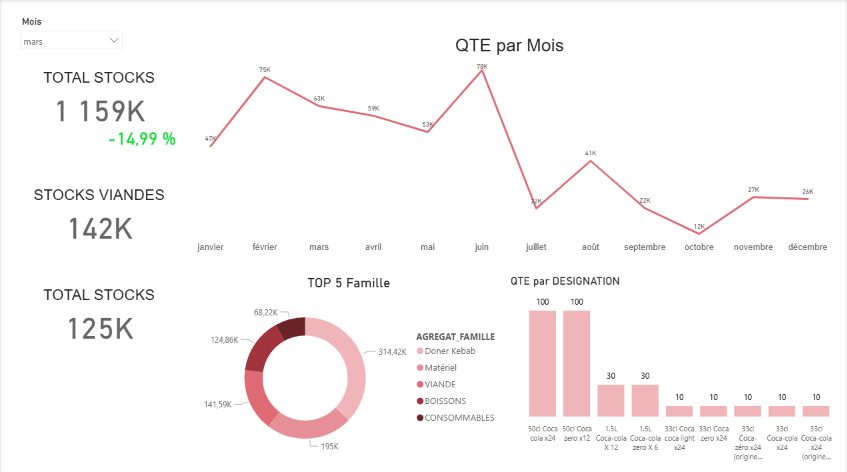
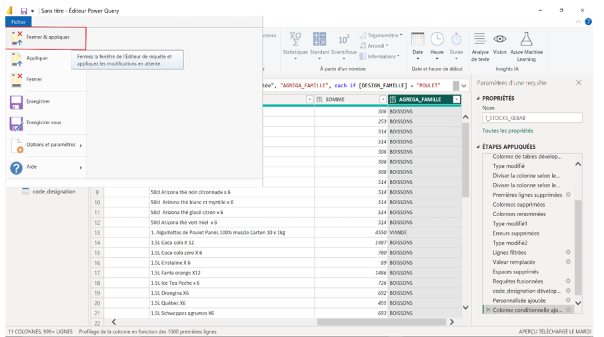

# Dashboard Power BI – Gestion de stock

Tableau de bord de suivi des stocks d'une entreprise de restauration (produits alimentaires, boissons, matériel), construit avec Power BI Desktop à partir de 12 fichiers Excel mensuels (année 2020).

*Projet académique – UE INF371, Université de Yaoundé I (2023-2024). Réalisé en suivant le tutoriel « Power BI Tutoriel Français – Les bases en 30 min » (lien à ajouter).*



## Objectif
Suivre l'évolution des stocks mois par mois, repérer les variations et comparer les grandes familles de produits.

## Données
- **12 fichiers Excel** (un par mois, `stocks_AAAAMMJJ.xlsx`) : code produit, quantité, prix unitaire, famille de produit.
- **1 fichier `code_designation.xlsx`** : table de correspondance entre le code et la désignation de chaque produit.

## Résultats clés
- **Stock de mars** : valeur totale de 1 159 K, en baisse de **14,99 %** par rapport au mois précédent.
- **Évolution annuelle** : les quantités en stock culminent en février (75 K) et en juin (78 K), chutent en juillet, atteignent leur point bas en octobre (12 K), puis remontent en fin d'année.
- **Répartition par famille** : la famille *Doner Kebab* pèse le plus (≈ 314 K), devant le *Matériel* (≈ 195 K). Viandes (≈ 142 K), boissons (≈ 125 K) et consommables (≈ 68 K) suivent.

## Comment je l'ai construit
1. **Organisation des fichiers** : dossiers `INPUT / RAPPORTS / OUTPUT` et renommage des fichiers au format date.
2. **Extraction (Power Query)** : import du dossier complet avec « Combiner et charger ».
3. **Transformation** :
   - extraction de la date depuis le nom du fichier ;
   - suppression des colonnes et lignes inutiles ;
   - promotion des en-têtes ;
   - typage des colonnes et suppression des erreurs et des valeurs `null` ;
   - nettoyage des espaces.
4. **Fusion des requêtes** : jointure externe gauche sur le code produit pour récupérer la désignation.
5. **Colonnes calculées** : coût total par ligne (`QTE × PRIX_U`) et colonne conditionnelle regroupant poulet, volaille et bœuf dans la catégorie `VIANDE`.
6. **Visualisations** :
   - segment par mois ;
   - cartes KPI (total du stock, stock viandes, stock boissons) ;
   - mesure rapide de variation M/M-1 avec mise en forme conditionnelle (vert si le stock baisse, rouge s'il augmente) ;
   - courbe d'évolution annuelle ;
   - anneau Top 5 des familles ;
   - histogramme filtré sur les boissons « coca ».

Exemple de mesure DAX :
```dax
Total stocks viandes =
CALCULATE(
    SUM('1_STOCKS_KEBAB'[SOMME]),
    '1_STOCKS_KEBAB'[AGREGA_FAMILLE] = "VIANDE"
)
```

## Aperçu du nettoyage


## Outils
Power BI Desktop · Power Query · DAX · Excel

## Fichiers
- `Dashboard_Stock.pbix` : le rapport Power BI
- `screenshots/` : captures d'écran
